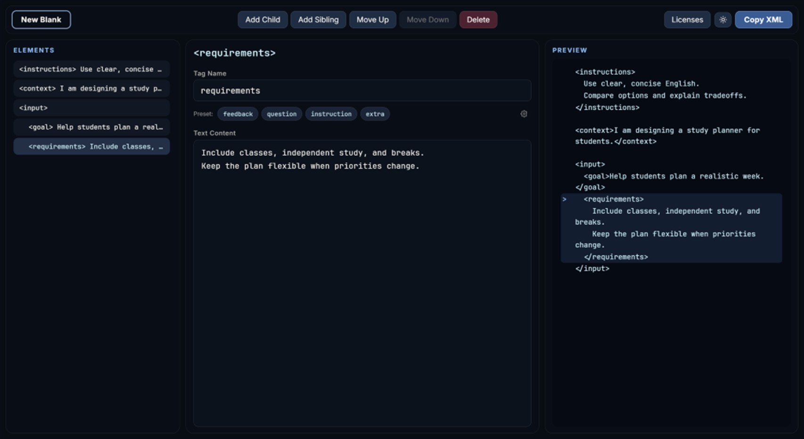

# XML Prompt Studio

[](LICENSE) [](https://github.com/koagaroon/xml-prompt-studio/releases) 

> **XML Prompt Studio 是一款桌面工具，用于编写、预览和复制面向大语言模型（LLM）工作流的 XML 风格提示词。** 你可以把 `<instructions>`、`<context>`、`<input>`、`<example>` 等提示词片段（section）组织成清晰的标签结构，然后复制到 Claude Code 等命令行工具或聊天工具中。
>
> _XML Prompt Studio is a desktop app for writing, previewing, and copying XML-style prompts for large language model (LLM) workflows._ You can organize sections such as `<instructions>`, `<context>`, `<input>`, and `<example>` into a clear tag structure, then copy them into Claude Code or another CLI/chat tool.

这款应用的功能设计刻意保持精简：它是一个 XML 提示词创作工具，而不是通用的 XML IDE。它采用仅含元素的提示词标记，支持多个顶层片段、重复的同名标签和 Unicode 标签名，并原样输出文本内容（所见即所得，WYSIWYG）。

This app is intentionally focused: it is an XML prompt authoring tool, not a general-purpose XML IDE. It uses element-only prompt markup, allows multiple top-level sections, supports repeated same-name tags, accepts Unicode tag names, and outputs text content exactly as written (WYSIWYG).



_在左侧组织提示词片段，在中间编辑内容，并在右侧预览输出。 / Organize prompt sections on the left, edit their content in the middle, and preview the output on the right._

---

## 目录 | Contents

- [下载 | Download](#下载--download)
- [功能 | Features](#功能--features)
- [支持范围 | Supported Scope](#支持范围--supported-scope)
- [使用方法 | Usage](#使用方法--usage)
- [预览与复制机制 | Preview and Copy Contract](#预览与复制机制--preview-and-copy-contract)
- [从源码构建 | Build from Source](#从源码构建--build-from-source)
- [架构 | Architecture](#架构--architecture)
- [许可证 | License](#许可证--license)

---

## 下载 | Download

Windows 用户可在 [Releases](https://github.com/koagaroon/xml-prompt-studio/releases) 页面下载免安装的便携版。

Windows users can download the portable, no-installer exe from the [Releases](https://github.com/koagaroon/xml-prompt-studio/releases) page.

- **`xml-prompt-studio.exe`** — 图形界面（GUI），适合手动编写和复制提示词结构
- **`xml-prompt-studio.exe`** — graphical interface (GUI), for manually composing and copying prompt structures

便携版需要 Windows 10 / 11（x64）和 [Microsoft Edge WebView2 Runtime](https://developer.microsoft.com/en-us/microsoft-edge/webview2/)。Windows 10 / 11 通常已预装 WebView2；运行下载的程序不需要 Node.js、npm、Rust 或 Visual Studio Build Tools。

The portable executable requires Windows 10 / 11 (x64) and the [Microsoft Edge WebView2 Runtime](https://developer.microsoft.com/en-us/microsoft-edge/webview2/), which is usually pre-installed. Running the downloaded app does not require Node.js, npm, Rust, or Visual Studio Build Tools.

> [!NOTE]
> 本项目仅支持 Windows，测试与交付目标为 Windows 10 / 11 x64 便携版。
>
> This project supports Windows only. Windows 10 / 11 x64 portable builds are tested and shipped.

---

## 功能 | Features

| 功能 / Feature                                        | 说明 / Description                                                                                                                                                                                                                                              |
| ----------------------------------------------------- | --------------------------------------------------------------------------------------------------------------------------------------------------------------------------------------------------------------------------------------------------------------- |
| **三栏编辑界面 / Three-column editor**                | 左侧元素列表，中间编辑当前元素，右侧实时预览 / Element outline on the left, focused element editor in the middle, live preview on the right                                                                                                                     |
| **多顶层提示词结构 / Multiple top-level sections**    | 可并列创建 `<instructions>`、`<context>`、`<input>` 等顶层标签，无需包裹进隐藏根节点 / Create top-level tags side by side, with no forced hidden wrapper root                                                                                                   |
| **嵌套元素编辑 / Nested element editing**             | 添加子元素、同级元素，上移 / 下移，删除元素（含正文或子元素时需确认） / Add children, add siblings, move elements up/down, and delete elements (with confirmation when removing text or child sections)                                                         |
| **同名标签有效 / Same-name tags are valid**           | `<example>` / `<example>` 或 `<document>` / `<document>` 这类重复同级标签不会产生警告 / Repeated sibling tags such as `<example>` / `<example>` or `<document>` / `<document>` do not produce warnings                                                          |
| **XML `Name` 校验 / XML Name validation**             | 标签名按 W3C XML 1.0 第五版 `Name` 规则校验，支持中文、日文、韩文、希腊文等 Unicode 名称 / Tag names are validated against the W3C XML 1.0 Fifth Edition `Name` production, including CJK, Greek, and other Unicode names                                       |
| **可编辑预设标签 / Editable preset chips**            | 默认 `feedback` / `question` / `instruction` / `extra`，可重命名、删除、添加，并持久化到 `localStorage` / Default chips are editable, removable, addable, and persisted through `localStorage`                                                                  |
| **预览内容 = 剪贴板内容 / Preview matches clipboard** | 右侧预览就是实际复制到剪贴板的文本 / The right-side preview is the text copied to the clipboard                                                                                                                                                                 |
| **剪贴板防护 / Clipboard safeguards**                 | 拒绝 NUL 字符、孤立 UTF-16 代理项以及超大 UTF-8 载荷，并在 Tauri 与浏览器两条剪贴板路径中均进行校验 / Rejects NUL characters, lone UTF-16 surrogates, and oversized UTF-8 payloads, with validation on both the Tauri and browser clipboard paths               |
| **主题与窗口体验 / Theme and window polish**          | 支持深色 / 浅色主题（初始跟随系统偏好）；启动时按 DPI 居中调整尺寸；存在提示词正文或新增片段时关闭窗口前提示确认 / Dark/light themes (system-preference default), DPI-aware centered launch, and close confirmation when prompt content or added sections exist |

> [!TIP]
> **中文标签名可用** — 例如 `<反馈>`、`<上下文>`、`<示例>` 都是有效标签名，只要符合 XML 1.0 `Name` 规则。
>
> **Chinese tag names work** — Names such as `<反馈>`, `<上下文>`, and `<示例>` are valid as long as they follow XML `Name` rules.

---

## 支持范围 | Supported Scope

XML Prompt Studio 输出的是提示词标记，而不是供 XML 解析器使用的严格数据文件。这个边界是产品设计的一部分。

XML Prompt Studio outputs prompt markup, not strict data files meant for XML parsers. This boundary is intentional.

| 项目 / Area                                         | 当前行为 / Current behavior                                                                                                              |
| --------------------------------------------------- | ---------------------------------------------------------------------------------------------------------------------------------------- |
| 文档形态 / Document shape                           | 非空森林模型：多个顶层元素并列存在 / Non-empty forest model: multiple top-level elements can sit side by side                            |
| 元素结构 / Element structure                        | 只有元素名、文本内容、子元素 / Element name, text content, and child elements only                                                       |
| 文本内容 / Text content                             | WYSIWYG：`<`、`>`、`&` 会原样输出，不自动转义 / WYSIWYG: `<`, `>`, and `&` are emitted literally, not escaped                            |
| 标签名 / Tag names                                  | 对去除首尾空白后的标签名按 XML 1.0 `Name` 规则校验 / XML 1.0 `Name` validation is applied to trimmed tag names                           |
| 顶层分隔 / Top-level separators                     | 复制时顶层片段之间用一个空行分隔，与预览一致 / One blank line is copied between top-level sections, matching the preview                 |
| 属性 / Attributes                                   | 不支持 / Not supported                                                                                                                   |
| 命名空间 / Namespaces                               | `:` 是 XML 1.0 `Name` 规则允许的字符，但不会解析命名空间语义 / `:` is allowed by XML Name syntax, but namespace semantics are not parsed |
| DTD / XSD / Schema                                  | 不支持 / Not supported                                                                                                                   |
| XPath / query tooling                               | 不支持 / Not supported                                                                                                                   |
| 严格单根 XML 文档 / Strict single-root XML document | 不强制；多个顶层提示词片段是正常用法 / Not enforced; multiple top-level prompt sections are normal                                       |
| 多文档工作区 / Multi-document workspace             | 不支持 / Not supported                                                                                                                   |

---

## 使用方法 | Usage

### 基本流程 | Basic Workflow

1. 点击 **New Blank** 从一个新的 `<feedback>` 片段开始。 / Click **New Blank** to start from a fresh `<feedback>` section.
2. 在左侧 **Elements** 列选择当前元素。 / Select the current element in the **Elements** column.
3. 在 **Tag Name** 中输入标签名，或点击预设标签自动填入标签名。 / Type a tag name in **Tag Name**, or click a preset chip to generate one.
4. 在 **Text Content** 中输入提示词正文。 / Write prompt text in **Text Content**.
5. 使用 **Add Child** / **Add Sibling** 扩展结构。 / Use **Add Child** / **Add Sibling** to grow the structure.
6. 在右侧 **Preview** 确认复制内容。 / Confirm the copied content in **Preview**.
7. 点击 **Copy XML**，把预览文本复制到剪贴板。 / Click **Copy XML** to copy the preview text to the clipboard.

### 示例 | Example

下面的示例展示多个顶层片段并列输出（中间用一个空行分隔）：单行文本保持单行输出，多行文本自动换行并缩进。

The example below shows multiple top-level sections emitted side by side (separated by one blank line): single-line text stays on one line, while multi-line text expands onto indented lines.

```xml
<instructions>
  Be direct and precise.
  Explain tradeoffs clearly.
</instructions>

<context>The user is editing a Tauri desktop app README.</context>

<input>Rewrite this section in a clearer public-facing style.</input>
```

### 预设标签 | Preset Chips

- 默认预设：`feedback`、`question`、`instruction`、`extra`
- 点击齿轮按钮进入编辑模式，可重命名、删除、添加或恢复默认预设
- 最多 6 个预设，每个名称最多 24 个 Unicode 码位
- 预设名称必须符合 XML 1.0 `Name` 规则，且在预设列表中唯一（不区分大小写）
- 为当前元素首次选择某个预设时，会生成形如 `feedback_1`、`feedback_2` 的标签名，后缀取同级元素中最小可用的正整数
- 连续点击同一个预设不会改变标签名；切换到其他预设再切回来，会恢复该元素记住的名称。手动编辑标签名不会清除这段历史记录

- Default presets: `feedback`, `question`, `instruction`, `extra`
- Click the cog button to enter edit mode, then rename, delete, add, or reset presets
- Up to 6 presets, with 24 code points per preset name
- Preset names must be valid XML names and unique within the preset list (case-insensitive)
- Selecting a preset for an element for the first time generates a name such as `feedback_1` or `feedback_2`, using the smallest available positive suffix among siblings
- Repeatedly clicking the same preset leaves the name unchanged. Switching to another preset and back restores that element's remembered name; manually editing its tag name does not erase this history

---

## 预览与复制机制 | Preview and Copy Contract

预览区必须可信：用户看到什么，复制出去的就应该是什么。

The preview is the trust surface: what you see should be what gets copied.

```text
XmlNode[] forest
  |
  v
buildPreview(roots)
  |
  +-- PreviewLine[] rendered in the Preview column
  |
  `-- PreviewLine.text joined with "\n"
        |
        v
      Clipboard payload
```

复制前会按优先级检查：

Copy checks run in this priority order:

1. 已有复制任务正在进行 / Another copy is already in progress
2. 预览尚未更新到最新编辑内容 / The preview has not updated to the latest edit yet
3. 存在无效标签名 / There are invalid tag names
4. 复制内容超过 50 MB UTF-8 上限 / The payload exceeds the 50 MB UTF-8 cap

如果预览仍在更新，**Copy XML** 会拒绝复制并提示等待，避免复制尚未更新的旧内容。

If the preview is still updating, **Copy XML** refuses the copy and asks you to wait, preventing outdated content from being copied.

---

## 从源码构建 | Build from Source

### 前置条件 | Prerequisites

以下工具版本仅适用于开发和从源码构建，会随经过验证的依赖更新而调整。

These tool versions apply to development and source builds and may advance with verified dependency updates.

- [Node.js](https://nodejs.org/) 24 LTS（长期支持版 / Long-Term Support）, satisfying `^24.21.0`
- npm 12.2.2（由 `packageManager` 固定 / pinned by `packageManager`）
- [Rust 工具链 / Rust toolchain](https://rustup.rs/) 1.100.0（由 `rust-toolchain.toml` 固定；Cargo 的 `rust-version` 与该构建基线保持一致，不单独承诺兼容更旧的编译器 / pinned by `rust-toolchain.toml`; Cargo's `rust-version` matches this build baseline, with no separate older-compiler compatibility promise）
- Windows: Visual Studio Build Tools (MSVC linker)
- Windows: WebView2 (Windows 10 / 11 通常已预装 / usually pre-installed on Windows 10 / 11)

### 开发 | Development

```powershell
npm ci
npm run tauri dev
```

如果看到 `'tauri' is not recognized`，通常是还没有运行 `npm ci`。

If you see `'tauri' is not recognized`, `npm ci` was probably skipped.

### 构建 | Production Build

```powershell
npm run tauri build
```

Windows 便携版会生成到：

The Windows portable exe is produced at:

```text
src-tauri/target/release/xml-prompt-studio.exe
```

`src-tauri/tauri.conf.json` 当前设置 `bundle.active: false`，所以默认输出是便携版，而不是 MSI / NSIS 安装包。

`src-tauri/tauri.conf.json` currently sets `bundle.active: false`, so the default output is a portable binary rather than an MSI / NSIS installer.

Windows 原生构建会先核对已锁定依赖、Rust 工具链与本地许可证清单，再构建前端；清单过期或缺失会阻止构建。检查覆盖仓库声明的标准配置；自定义功能、配置文件或编译器覆盖设置需要单独审核。单独运行 `npm run dev` / `npm run build` 仍只需 Node，不会启动 Rust。原生应用与构建检查仅支持 Windows；已审核的许可证清单覆盖 Windows x64 MSVC。

Windows native builds first compare locked dependencies and the Rust toolchain with the local license inventory, then build the frontend. Missing or stale inventory data blocks the build. The check covers the repository's declared standard profile; custom features, configuration files, or compiler overrides require separate review. Standalone `npm run dev` / `npm run build` remain Node-only and do not invoke Rust. The native app and build checks support Windows only; the reviewed license inventory covers Windows x64 MSVC.

### 测试 | Testing

```powershell
npm run lint
npm run test
npm run typecheck:all
npm run build
npm run native-notices:check
npm run audit:dependencies
cargo check --manifest-path src-tauri/Cargo.toml --locked --all-targets
```

拆分后的命令：

Split commands:

```powershell
npm run lint:js
npm run lint:css
npm run lint:rs
npm run test:js
npm run test:rs
npm run typecheck:ts7
npm run typecheck:ts6
```

发布构建使用原生 TypeScript 7 进行类型检查，并以 `typescript-release` 别名安装，避免与 `typescript-eslint` 为实验性 TypeScript 7.1 支持使用的 `@typescript/native` 名称冲突。ESLint 和 `typescript-eslint` 通过官方 `@typescript/typescript6` 兼容包继续使用 TypeScript 6 的程序化 API。请使用上面的 `npm run typecheck:*` 脚本，不要依赖裸 `tsc` 或 `npx tsc` 的解析顺序。

Release builds use native TypeScript 7 for type-checking, installed as `typescript-release` to avoid colliding with the `@typescript/native` name that `typescript-eslint` uses for experimental TypeScript 7.1 support. ESLint and `typescript-eslint` continue to use TypeScript 6's programmatic API through the official `@typescript/typescript6` compatibility package. Use the `npm run typecheck:*` scripts above instead of relying on bare `tsc` or `npx tsc` resolution order.

Node 类型定义与 `package.json` 声明的 Node LTS 构建主版本保持一致；两套 TypeScript 检查均覆盖 Node 配置和维护脚本，持续集成在当前 Node 24 LTS 上运行。Dependency Watch 会报告该主版本下的最新稳定类型更新，并将更高主版本的类型定义标记为有意暂缓。

Node type definitions track the Node LTS build major declared in `package.json`. Both TypeScript checks cover Node configuration and maintenance scripts, and CI runs on current Node 24 LTS. Dependency Watch reports newer stable type releases within that major while holding newer majors.

Dependency Watch 检查直接依赖、固定的 npm 与 Rust 构建工具、GitHub Actions，以及 TypeScript 兼容编译器和 Rolldown 原生绑定等特定间接依赖。报告会区分开发工具与运行时依赖，但不是完整锁文件的更新清单，也不代表每个列出的包都进入了 `.exe`。常规版本更新会写入输出与 GitHub Actions 任务摘要并以退出码 `0` 结束；未审核的已发布包安全公告返回退出码 `1`，监控程序错误返回退出码 `2`。构建工具更新属于开发维护；下载便携版的用户不需要安装这些工具。

Dependency Watch checks direct dependencies, pinned npm and Rust build tools, GitHub Actions, and selected indirect dependencies such as the TypeScript compatibility compiler and Rolldown native bindings. It distinguishes development tools from runtime dependencies, but is neither a complete lockfile update inventory nor proof that every listed package enters the `.exe`. Routine version updates are written to output and the GitHub Actions job summary with exit code `0`; unaccepted released-package advisories exit `1` and monitor errors exit `2`. Build-tool updates are maintainer work; portable-app users do not need to install these tools.

报告还会将最新稳定 Windows 发布版的标签解析到确定的提交，读取该提交中的锁文件与已审核的 Windows 许可证清单，列出开发版本与已发布版本的依赖差异，并向 [OSV](https://osv.dev/) 查询已发布 npm 运行时包与链接进 Windows 可执行文件的 Rust 运行时依赖的安全公告（不包含仅开发时使用的打包器与仅构建辅助包）。未接受的匹配公告会使检查失败；[`audit-ci.json`](audit-ci.json) 中未过期的已审核例外会保留在报告详情中供复核。没有匹配不代表应用已被证明安全。此查询不覆盖 Rust 标准库、非包形式的资源、外部 WebView2 运行时、仅构建时使用的依赖或更早的发布版，也不会自动构建或发布应用。

The report also resolves the latest stable Windows release tag to a fixed commit, reads its lockfiles and reviewed Windows notice inventory, shows dependency differences from development, and queries [OSV](https://osv.dev/) for advisories affecting shipped npm runtime packages and linked Windows Rust runtime crates (excluding dev-only bundlers and build-support crates). Unaccepted matches fail the check; unexpired reviewed exceptions in [`audit-ci.json`](audit-ci.json) remain visible in the release details. No matches do not prove the app is secure. This query excludes the Rust standard library, non-package assets, the external WebView2 runtime, build-only dependencies, and older releases. It does not build or publish the app automatically.

Rolldown 更新会检查仍符合 Vite 要求且已为维护中的构建环境 Windows x64 MSVC 完整发布的最新稳定版本。较新但尚未完整发布的版本会单独说明，不会遮住已经可用的更新；其他平台的发布问题仅供参考。`npm ci` 仍负责验证锁文件安装。

Rolldown updates select the newest Vite-compatible stable release fully published for the maintained build host: Windows x64 MSVC. A newer incomplete release is explained without hiding an available update; other-platform publication gaps are informational. `npm ci` continues to verify the locked installation.

`npm run audit:dependencies` 会先向 npm 注册表检查生产依赖与包含开发工具的完整 npm 依赖树，再向 [OSV](https://osv.dev/) 查询已锁定的 Windows 运行时包清单（含链接进可执行文件的 Rust 依赖）。npm 生产依赖不允许例外；npm 开发依赖与经过适用性审核的 OSV 例外必须在 [`audit-ci.json`](audit-ci.json) 中列明精确公告、目标范围、原因与到期时间。例外到期后，对应问题会重新阻止检查通过；新增漏洞、查询失败或报告异常也会阻止检查通过。CI、Dependency Watch 与发布前检查共用此命令。通过项目检查不代表底层审计没有发现已接受的问题。

`npm run audit:dependencies` queries the npm registry for production dependencies and the complete npm graph (including development tools), then queries [OSV](https://osv.dev/) for the locked Windows runtime package inventory (including linked Rust runtime crates). Production npm dependencies have no exceptions. Development npm exceptions and reviewed OSV exceptions in [`audit-ci.json`](audit-ci.json) require an exact advisory, target identity/scope, reason, and expiry. An expired exception no longer accepts its finding. New findings, request failures, and invalid reports also block the check. CI, Dependency Watch, and release preparation share this command. Passing the project check does not mean the underlying registries reported zero findings when unexpired exceptions apply.

---

## 架构 | Architecture

```text
+----------------------------------------------------------------------+
| React + TypeScript frontend                                          |
| - App.tsx + UI components: state, layout, dialogs, and controls      |
| - presets.ts / theme.ts: preset suffix memory and theme persistence  |
| - document.ts: immutable tree operations                             |
| - xml.ts: validation and preview rendering                           |
| - helpers.ts: pure limits, copy readiness, outline & delete helpers  |
| - tauri.ts: clipboard bridge, close guard, and startup show request  |
+----------------------------------------------------------------------+
                                   |
                                Tauri IPC
                                   |
+----------------------------------------------------------------------+
| Rust native layer                                                    |
| - copy_xml_to_clipboard: serialized clipboard boundary               |
| - arboard Windows clipboard access                                  |
| - native fallback: trusted Windows clip.exe                         |
| - close-confirmation guard, launch sizing, and show fallback         |
+----------------------------------------------------------------------+
```

重要设计约束：

Important design locks:

| 约束 / Lock                                 | 说明 / Description                                                                                                                                         |
| ------------------------------------------- | ---------------------------------------------------------------------------------------------------------------------------------------------------------- |
| 应用版本来源 / App version source           | `src-tauri/Cargo.toml` 是应用版本的唯一来源 / `src-tauri/Cargo.toml` is the app-version source of truth                                                    |
| Tauri 配置版本 / Tauri config version       | `tauri.conf.json` 刻意省略 `version` / `tauri.conf.json` intentionally omits `version`                                                                     |
| 预览与复制管线 / Preview and copy pipeline  | `buildPreview(roots)` 同时驱动预览和复制 XML / `buildPreview(roots)` is the shared source for preview and copied XML                                       |
| Content Security Policy (CSP, 内容安全策略) | 生产敏感代码避免 inline styles/scripts / Avoid inline styles/scripts in production-sensitive code                                                          |
| 原生层边界 / Native layer boundary          | Rust 层保持精简；除非必须使用原生 API，产品逻辑放在前端 / The Rust layer stays thin; product logic belongs in the frontend unless native APIs are required |

---

## 许可证 | License

Copyright (c) 2026 koagaroon

本项目采用 [MIT License](LICENSE) 授权。

This project is licensed under the [MIT License](LICENSE).

### 捆绑字体 | Bundled Fonts

`public/fonts/` 中的字体会随应用一起分发，并按各自的 SIL Open Font License (OFL) Version 1.1 授权，而不是项目的 MIT License。完整许可证文本已随字体文件一并提供。

The fonts in `public/fonts/` ship with the application and are licensed under their own SIL Open Font License (OFL) Version 1.1, not under the project's MIT License. The full license texts are included alongside the font files.

| 字体 / Font                                          | 许可证 / License                                                | 用途 / Usage                                                                    |
| ---------------------------------------------------- | --------------------------------------------------------------- | ------------------------------------------------------------------------------- |
| [Inter](https://rsms.me/inter/)                      | [SIL Open Font License 1.1](public/fonts/Inter-LICENSE.txt)     | UI 正文、标签和控件 / UI body, labels, and controls                             |
| [JetBrains Mono](https://www.jetbrains.com/lp/mono/) | [SIL Open Font License 1.1](public/fonts/JetBrainsMono-OFL.txt) | XML 预览、标签名和等宽 UI 文本 / XML preview, tag names, and monospaced UI text |

署名信息索引见 [public/fonts/LICENSES.md](public/fonts/LICENSES.md) 和 [THIRD-PARTY-NOTICES.md](THIRD-PARTY-NOTICES.md)。

See [public/fonts/LICENSES.md](public/fonts/LICENSES.md) and [THIRD-PARTY-NOTICES.md](THIRD-PARTY-NOTICES.md) for the short attribution index.

### 第三方依赖 | Third-Party Dependencies

下表列出主要直接依赖和随应用分发的资产；完整的传递依赖链请分别参见 `package-lock.json` 和 `src-tauri/Cargo.lock`。

The tables below list the main direct dependencies and bundled assets; for the full transitive dependency graph, see `package-lock.json` and `src-tauri/Cargo.lock`.

应用中的 **Licenses** 按钮可离线查看前端许可证、捆绑资产署名，以及已审核的 Windows 原生依赖、Rust 标准库和 WebView2 静态加载器声明。生成过程使用已锁定的 npm 包及版本化的原生清单，并核对分发目录中的副本。清单从宽收录了相关构建依赖，不表示每个组件的所有代码都进入了可执行文件；详见 [Third-Party Notices](THIRD-PARTY-NOTICES.md)。

The **Licenses** button opens frontend licenses, bundled asset attributions, and the reviewed Windows native dependency, Rust standard-library, and WebView2 static-loader notices offline. Generation uses locked npm packages and the versioned native inventory, then verifies the packaged copy. The inventory conservatively includes relevant build dependencies; it does not imply that every component's entire code appears in the executable. See [Third-Party Notices](THIRD-PARTY-NOTICES.md).

#### 运行时依赖（随应用分发）| Runtime (shipped with the application)

| 组件 / Component                                                                  | 许可证 / License  | 用途 / Usage                                                                  |
| --------------------------------------------------------------------------------- | ----------------- | ----------------------------------------------------------------------------- |
| [Tauri](https://tauri.app/)                                                       | MIT OR Apache-2.0 | 桌面应用框架 / Desktop app framework                                          |
| [@tauri-apps/api](https://github.com/tauri-apps/tauri)                            | MIT OR Apache-2.0 | 前端到 Rust 的 IPC 桥接 / Frontend-to-Rust IPC bridge                         |
| [React](https://react.dev/) / React DOM                                           | MIT               | UI 框架 / UI framework                                                        |
| [Scheduler](https://github.com/facebook/react/tree/main/packages/scheduler)       | MIT               | React DOM 的调度依赖 / React DOM scheduling dependency                        |
| [Vite runtime helpers](https://vite.dev/config/build-options#build-modulepreload) | MIT               | 构建时注入的模块预加载辅助代码 / Module preload helper emitted by the build   |
| [Rolldown](https://github.com/rolldown/rolldown)                                  | MIT               | CommonJS 模块加载代码 / CommonJS module loader emitted by the build           |
| [Feather](https://github.com/feathericons/feather)                                | MIT               | 月亮图标（保守起见，仍保留署名） / Conservative attribution for the moon icon |
| [arboard](https://github.com/1Password/arboard)                                   | MIT OR Apache-2.0 | Windows 剪贴板访问 / Windows clipboard access                                 |
| [Inter](https://rsms.me/inter/)                                                   | SIL OFL 1.1       | 捆绑 UI 字体 / Bundled UI font                                                |
| [JetBrains Mono](https://www.jetbrains.com/lp/mono/)                              | SIL OFL 1.1       | 捆绑等宽字体 / Bundled monospace font                                         |

#### 构建时依赖（不随应用分发）| Build-time only (not shipped)

| 组件 / Component                                                    | 许可证 / License  | 用途 / Usage                                                                                                      |
| ------------------------------------------------------------------- | ----------------- | ----------------------------------------------------------------------------------------------------------------- |
| [TypeScript](https://www.typescriptlang.org/)                       | Apache-2.0        | TypeScript 7 发布检查 + TypeScript 6 API 兼容层 / TS7 release gate + TS6 API compatibility layer                  |
| [Vite](https://vite.dev/)                                           | MIT               | 前端构建工具；随应用分发的辅助代码见上表 / Frontend build tool; emitted runtime helpers are listed above          |
| [@vitejs/plugin-react](https://github.com/vitejs/vite-plugin-react) | MIT               | Vite React 支持 / React support for Vite                                                                          |
| [Tauri CLI](https://tauri.app/)                                     | MIT OR Apache-2.0 | Tauri 构建入口 / Tauri build entry point                                                                          |
| [tauri-build](https://github.com/tauri-apps/tauri)                  | MIT OR Apache-2.0 | Tauri Rust 构建脚本辅助工具 / Tauri Rust build script helper                                                      |
| [ESLint](https://eslint.org/)                                       | MIT               | JavaScript / TypeScript 代码检查 / JavaScript and TypeScript linting                                              |
| [Prettier](https://prettier.io/)                                    | MIT               | JavaScript、TypeScript、CSS、JSON 与 Markdown 格式化 / JavaScript, TypeScript, CSS, JSON, and Markdown formatting |
| [Stylelint](https://stylelint.io/)                                  | MIT               | CSS 代码检查 / CSS linting                                                                                        |
| [audit-ci](https://github.com/IBM/audit-ci)                         | Apache-2.0        | 开发依赖审计例外的到期管理 / Expiry handling for development audit exceptions                                     |
| [Vitest](https://vitest.dev/)                                       | MIT               | 单元测试 / Unit testing                                                                                           |
| [tempfile](https://docs.rs/tempfile/)                               | MIT OR Apache-2.0 | Rust 测试的临时目录管理 / Temporary directories for Rust tests                                                    |
